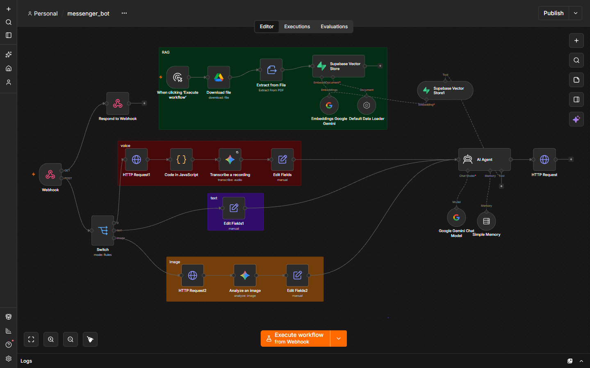

# ☕ AI-Powered Multimodal Customer Service Chatbot

An intelligent, multilingual customer service chatbot built with **n8n, Google Gemini, and Supabase**, designed to automate customer interactions through Facebook Messenger.

The project combines **LLMs, Retrieval-Augmented Generation (RAG), workflow automation, and multimodal AI** to understand and respond to text, voice, and image messages.


## ✨ Key Features

- 💬 **Text Conversations:** Answers customer questions using a dedicated knowledge base.
- 🎙️ **Voice Processing:** Transcribes voice messages and processes them using AI.
- 🖼️ **Image Understanding:** Analyzes customer-submitted images using Gemini's vision capabilities.
- 📚 **RAG Integration:** Retrieves relevant information from a PDF knowledge base using Supabase vector search.
- 🧠 **Conversational Memory:** Maintains context across customer interactions.
- 🌍 **Multilingual Support:** Designed to handle English, French and Arabic.
- ⚙️ **Automated Responses:** Handles incoming messages and sends AI-generated replies through Facebook Messenger.

## 🛠️ Tech Stack

| Technology | Purpose |
|---|---|
| n8n | Workflow automation and orchestration |
| Google Gemini | Language model, embeddings, transcription, and image analysis |
| Supabase | Vector database and semantic retrieval |
| Meta Graph API | Facebook Messenger integration |
| RAG | Knowledge-grounded AI responses |

## 🏗️ Architecture

The chatbot follows an automated workflow:

1. **Message Reception:** Facebook Messenger sends incoming messages to an n8n webhook.
2. **Input Detection:** The workflow identifies whether the message contains text, audio, or an image.
3. **Multimodal Processing:** Text is processed directly, audio is transcribed, and images are analyzed using Gemini.
4. **Knowledge Retrieval:** The AI agent retrieves relevant information from the PDF knowledge base through Supabase.
5. **Response Generation:** Gemini generates a contextual response using retrieved information and conversation history.
6. **Message Delivery:** The response is sent back to the customer through the Meta Graph API.

## 🎬 Demo

Explore the chatbot's functionality through a practical demonstration.

**Demo video:** [Watch Demo](demo/demo.mp4)

**Workflow overview:**



## 📁 Project Structure

```text
.
├── README.md
├── workflow/
│   └── messenger_bot.json
├── knowledge-base/
│   └── coffee_lab_knowledge_base.pdf
└── demo/
    ├── demo.mp4
    └── workflow.png
```

### Installation & Configuration

1. **Import the workflow:** Import `workflow/messenger_bot.json` into your n8n instance.
2. **Configure Gemini:** Add your Google Gemini credentials.
3. **Configure Supabase:** Connect your project and set up the vector-store table.
4. **Upload the knowledge base:** Use the provided PDF and configure the document ingestion and embedding workflow.
5. **Configure Meta:** Set up your Facebook Page, access token, Meta app, and webhook.
6. **Test the chatbot:** Verify text, voice, and image processing before activating the workflow.

## 👨‍💻 About

Developed as a personal project to explore practical applications of:

- Large Language Models (LLMs)
- Multimodal AI
- Retrieval-Augmented Generation (RAG)
- Vector databases and embeddings
- AI agents and workflow automation
- Conversational AI systems
